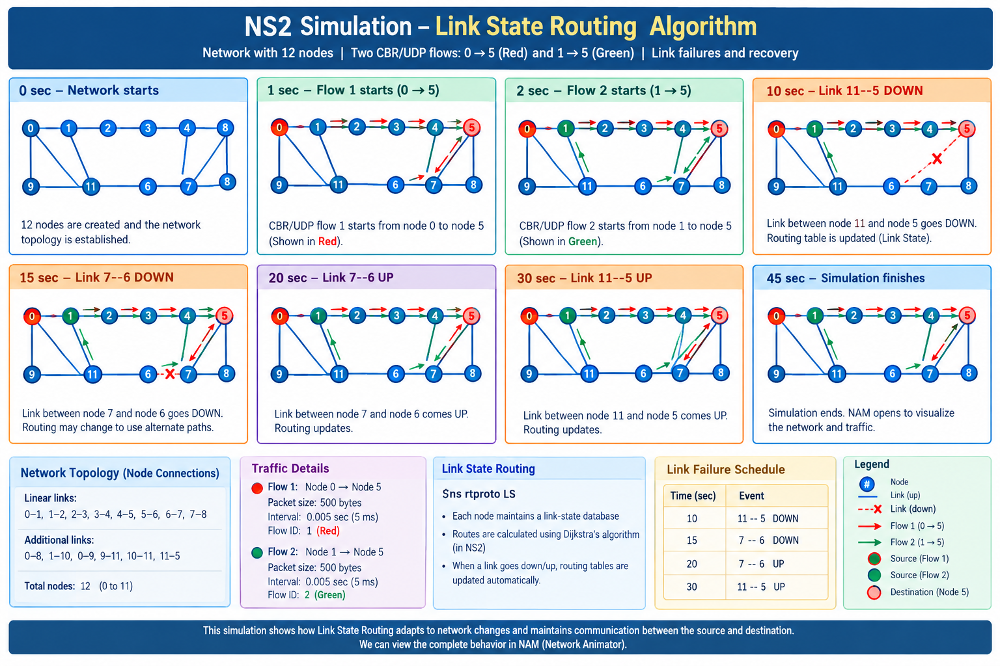

# Experiment 10 — Link State routing using NS2

[Back to experiment index](../README.md)

The network and event schedule are preserved from the supplied document. This Tcl script has not been executed in NS2 in this environment.

## Aim

To simulate Link State routing with two traffic flows and observe adaptation to link failures and recoveries.

## Algorithm

1. Create the simulator and open packet and NAM trace files.
2. Create 12 nodes and connect the links shown in the script.
3. Configure UDP/CBR flows from node 0 to node 5 and from node 1 to node 5.
4. Enable LS routing and assign distinct flow colors.
5. Start the flows at one and two seconds.
6. Schedule link failures at 10 and 15 seconds.
7. Restore the links at 20 and 30 seconds.
8. Finish at 45 seconds, close the trace files, and open NAM.

## Program

Source file: [link_state.tcl](link_state.tcl)

Run from this experiment folder:

```bash
ns link_state.tcl
```

Requires an NS2 installation with LS routing support and NAM. The script generates `thro.tr` and `thro.nam`.

```tcl
set ns [new Simulator]
set nr [open thro.tr w]
$ns trace-all $nr
set nf [open thro.nam w]
$ns namtrace-all $nf
proc finish { } {
global ns nr nf
$ns flush-trace
close $nf
close $nr
exec nam thro.nam &
exit 0
}
for { set i 0 } { $i < 12} { incr i 1 } {
set n($i) [$ns node]}
for {set i 0} {$i < 8} {incr i} {
$ns duplex-link $n($i) $n([expr $i+1]) 1Mb 10ms DropTail }
$ns duplex-link $n(0) $n(8) 1Mb 10ms DropTail
$ns duplex-link $n(1) $n(10) 1Mb 10ms DropTail
$ns duplex-link $n(0) $n(9) 1Mb 10ms DropTail
$ns duplex-link $n(9) $n(11) 1Mb 10ms DropTail
$ns duplex-link $n(10) $n(11) 1Mb 10ms DropTail
$ns duplex-link $n(11) $n(5) 1Mb 10ms DropTail
set udp0 [new Agent/UDP]
$ns attach-agent $n(0) $udp0
set cbr0 [new Application/Traffic/CBR]
$cbr0 set packetSize_ 500
$cbr0 set interval_ 0.005
$cbr0 attach-agent $udp0
set null0 [new Agent/Null]
$ns attach-agent $n(5) $null0
$ns connect $udp0 $null0
set udp1 [new Agent/UDP]
$ns attach-agent $n(1) $udp1
set cbr1 [new Application/Traffic/CBR]
$cbr1 set packetSize_ 500
$cbr1 set interval_ 0.005
$cbr1 attach-agent $udp1
set null0 [new Agent/Null]
$ns attach-agent $n(5) $null0
$ns connect $udp1 $null0
$ns rtproto LS
$ns rtmodel-at 10.0 down $n(11) $n(5)
$ns rtmodel-at 15.0 down $n(7) $n(6)
$ns rtmodel-at 30.0 up $n(11) $n(5)
$ns rtmodel-at 20.0 up $n(7) $n(6)
$udp0 set fid_ 1
$udp1 set fid_ 2
$ns color 1 Red
$ns color 2 Green
$ns at 1.0 "$cbr0 start"
$ns at 2.0 "$cbr1 start"
$ns at 45 "finish"
$ns run
```

## Output

The supplied document includes this explanatory illustration, not a captured NAM execution:



Expected simulation events:

| Time | Event |
| --- | --- |
| 1 s | Flow 1 starts from node 0 to node 5 |
| 2 s | Flow 2 starts from node 1 to node 5 |
| 10 s | Link 11–5 goes down |
| 15 s | Link 7–6 goes down |
| 20 s | Link 7–6 comes up |
| 30 s | Link 11–5 comes up |
| 45 s | Simulation finishes |

Run NS2/NAM to observe actual paths and packet behavior.

## Result

The experiment demonstrates Link State route computation and adaptation to scheduled topology changes. Confirm the actual paths and transitions by running the simulation.
