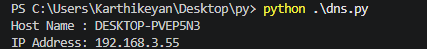

# Experiment 11 — Local DNS server hostname and IP address

[Back to experiment index](../README.md)

The experiment title is retained from the supplied document. Its code actually obtains the **local computer’s** details, not the local DNS server’s identity. Connecting this UDP socket selects a route; the program does not send a DNS query. A usable network route is required.

## Aim

To display the local computer’s hostname and the IPv4 address selected for an outbound route, using the supplied program.

## Algorithm

1. Import socket and obtain the local computer hostname.
2. Create an IPv4 UDP socket.
3. Connect the socket to 8.8.8.8 on port 80 to select a local route.
4. Read the local IP address with getsockname().
5. Close the socket.
6. Display the hostname and local IP address.

## Program

Source file: [local_hostname_ip.py](local_hostname_ip.py)

Run from this experiment folder:

```bash
python3 local_hostname_ip.py
```

```python
import socket
# Get hostname
hostname = socket.gethostname()
# Create a socket
s = socket.socket(socket.AF_INET, socket.SOCK_DGRAM)
try:
 # Connect to a public DNS server (no data is sent)
 s.connect(("8.8.8.8", 80))
 ip_address = s.getsockname()[0]
finally:
 s.close()
print("Host Name :", hostname)
print("IP Address:", ip_address)
```

## Output

Sample output from the supplied lab material. Values depend on the computer and network.



## Result

The program displays the local computer’s hostname and selected local IPv4 address. It does not discover the configured DNS resolver’s hostname or IP address.

Reference: [Python socket documentation](https://docs.python.org/3/library/socket.html).
