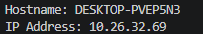
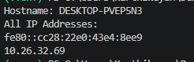
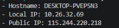
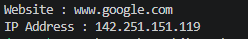
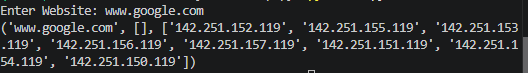
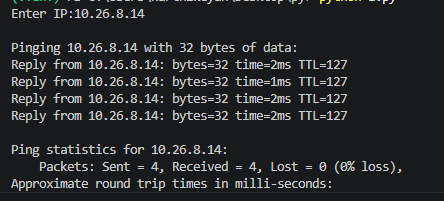
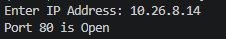

# Experiment 2 — Network addressing and utilities

[Back to experiment index](../README.md)

This experiment contains seven programs, grouped as A–G. Python 3 is required. DNS lookups and the public IP program need network access. Use your own lab host for the port check.

The ping program sends four requests on Windows, macOS, or Linux. The port check includes a timeout so unavailable ports do not block indefinitely.

## A — Hostname and IP address

### Aim

To obtain the hostname and its IPv4 address using Python.

### Algorithm

1. Import the socket module.
2. Read the local hostname with gethostname().
3. Resolve the hostname with gethostbyname().
4. Display the hostname and IP address.

### Program

Source file: [A_hostname_ip.py](A_hostname_ip.py)

Run from this experiment folder:

```bash
python3 A_hostname_ip.py
```

```python
import socket

# Get the hostname of the machine
hostname = socket.gethostname()

# Get the IP address associated with the hostname
ip_address = socket.gethostbyname(hostname)

# Display the results
print("Hostname:", hostname)
print("IP Address:", ip_address)
```

### Output

Sample output from the supplied lab material. Values depend on the computer and network.



### Result

The hostname and its resolved IPv4 address are displayed.

## B — IP addresses associated with the system hostname

### Aim

To display the unique IP addresses returned for the system hostname.

### Algorithm

1. Import socket and obtain the hostname.
2. Call getaddrinfo() for the hostname.
3. Collect the address field from each result in a set to remove duplicates.
4. Print the hostname and each unique address.

### Program

Source file: [B_all_ip_addresses.py](B_all_ip_addresses.py)

Run from this experiment folder:

```bash
python3 B_all_ip_addresses.py
```

```python
import socket
hostname = socket.gethostname()

# Get all address information
addresses = socket.getaddrinfo(hostname, None)

print("Hostname:", hostname)
print("All IP Addresses:")

ip_list = set()
for addr in addresses:
    ip = addr[4][0]
    ip_list.add(ip)

for ip in ip_list:
    print(ip)
```

### Output

Sample output from the supplied lab material. Values depend on the computer and network.



### Result

The distinct IPv4 and IPv6 addresses returned by hostname resolution are listed. This lookup does not necessarily enumerate every network interface.

## C — Public IP address

### Aim

To display the hostname, local IPv4 address, and public IP address.

### Algorithm

1. Get the hostname and resolve its local IPv4 address.
2. Request the JSON response from the ipify service with a five-second timeout.
3. Read the ip field from the response.
4. Report a network error if the request fails.
5. Display the hostname, local IP, and public IP.

### Program

Source file: [C_public_ip.py](C_public_ip.py)

Run from this experiment folder:

```bash
python3 C_public_ip.py
```

```python
import json
import socket
from urllib.request import urlopen

hostname = socket.gethostname()
local_ip = socket.gethostbyname(hostname)

try:
    with urlopen("https://api.ipify.org?format=json", timeout=5) as response:
        data = json.load(response)
        public_ip = data.get("ip", "Unknown")
except Exception as e:
    public_ip = f"Unable to fetch public IP: {e}"

print("- Hostname:", hostname)
print("- Local IP:", local_ip)
print("- Public IP:", public_ip)
```

### Output

Sample output from the supplied lab material. Values depend on the computer and network.



### Result

The program displays local host details and the public IP reported by ipify when the internet request succeeds.

## D — Website IP address

### Aim

To resolve a website hostname to an IPv4 address.

### Algorithm

1. Import socket.
2. Set the website hostname to www.google.com.
3. Resolve the hostname using gethostbyname().
4. Display the website and resolved IP address.

### Program

Source file: [D_website_ip.py](D_website_ip.py)

Run from this experiment folder:

```bash
python3 D_website_ip.py
```

```python
import socket

website = "www.google.com"

ip = socket.gethostbyname(website)

print("Website :", website)
print("IP Address :", ip)
```

### Output

Sample output from the supplied lab material. Values depend on the computer and network.



### Result

A website hostname is resolved to an IPv4 address.

## E — DNS lookup

### Aim

To obtain a hostname, aliases, and IPv4 addresses through DNS lookup.

### Algorithm

1. Import socket.
2. Read the website hostname from the user.
3. Call gethostbyname_ex() with the entered hostname.
4. Display the returned hostname, aliases, and IP address list.

### Program

Source file: [E_dns_lookup.py](E_dns_lookup.py)

Run from this experiment folder:

```bash
python3 E_dns_lookup.py
```

```python
import socket

host = input("Enter Website: ")

print(socket.gethostbyname_ex(host))
```

### Output

Sample output from the supplied lab material. Values depend on the computer and network.



### Result

The DNS lookup returns the canonical hostname, aliases, and IPv4 addresses available for the requested host.

## F — Ping

### Aim

To test IP connectivity using four ICMP echo requests.

### Algorithm

1. Read and validate the target IP address.
2. Select the packet-count option for the operating system.
3. Run ping with a count of four and the entered address.
4. Observe replies, round-trip times, and packet-loss statistics.

### Program

Source file: [F_ping.py](F_ping.py)

Run from this experiment folder:

```bash
python3 F_ping.py
```

```python
import ipaddress
import platform
import subprocess

host = input("Enter IP: ").strip()
# Validate the address and pass arguments directly to ping.
ipaddress.ip_address(host)
count_flag = "-n" if platform.system() == "Windows" else "-c"
subprocess.run(["ping", count_flag, "4", host], check=False)
```

### Output

Sample output from the supplied lab material. Values depend on the computer and network.



### Result

Ping reports reachability and round-trip statistics, subject to the target and network allowing ICMP.

## G — Open port numbers

### Aim

To identify accepting TCP ports in the range 1–100 on a lab host.

### Algorithm

1. Read and validate the target IPv4 address.
2. For each port from 1 through 100, create a TCP socket.
3. Set a short connection timeout and call connect_ex().
4. Print the port when the connection succeeds.
5. Close the socket before checking the next port.

### Program

Source file: [G_port_numbers.py](G_port_numbers.py)

Run from this experiment folder:

```bash
python3 G_port_numbers.py
```

```python
import ipaddress
import socket

target = input("Enter IP Address: ").strip()
ipaddress.IPv4Address(target)

for port in range(1, 101):
    with socket.socket(socket.AF_INET, socket.SOCK_STREAM) as s:
        s.settimeout(0.2)
        result = s.connect_ex((target, port))
        if result == 0:
            print("Port", port, "is Open")
```

### Output

Sample output from the supplied lab material. Values depend on the computer and network.



### Result

The program lists ports in the selected range that accept a TCP connection.
