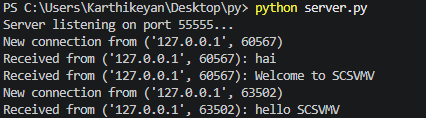
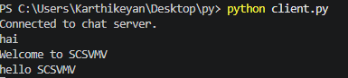
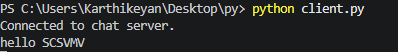

# Experiment 5 — TCP multi-client chat

[Back to experiment index](../README.md)

Run the server first, then start at least two clients on the same computer. Enter `exit` in a client to disconnect. If port `55555` is already in use, choose an unused port and update it in both files. This is a basic classroom chat example; TCP does not preserve application message boundaries.

## A — Chat server

### Aim

To accept multiple TCP clients and broadcast each received message to the other clients.

### Algorithm

1. Create a TCP socket, enable address reuse, and bind to localhost on port 55555.
2. Listen for incoming clients.
3. Accept a client and add its socket to the clients list.
4. Start a separate thread to receive messages from that client.
5. Send each received message to every other connected client.
6. Remove and close a client socket when it disconnects.

### Program

Source file: [A_chat_server.py](A_chat_server.py)

Start the server in terminal 1:

```bash
python3 A_chat_server.py
```

```python
import socket
import threading
clients = []
def handle_client(client_socket, client_address):
    print(f"New connection from {client_address}")
    while True:
        try:
            message = client_socket.recv(1024).decode()
            if not message:
                break
            print(f"Received from {client_address}: {message}")
            # Broadcast message to all other clients
            for client in clients:
                if client != client_socket:
                    client.sendall(message.encode())
        except Exception as e:
            print(f"Error with {client_address}: {e}")
            break
    # Remove disconnected client
    if client_socket in clients:
        clients.remove(client_socket)
    client_socket.close()
    print(f"{client_address} disconnected")
def chat_server():
    # Create TCP socket
    server_socket = socket.socket(
        socket.AF_INET,
        socket.SOCK_STREAM
    )
    # Allow immediate reuse of the port
    server_socket.setsockopt(
        socket.SOL_SOCKET,
        socket.SO_REUSEADDR,
        1
    )

    # Bind server to localhost and port 55555
    server_socket.bind(('localhost', 55555))

    # Listen for incoming connections
    server_socket.listen(5)
    print("Server listening on port 55555...")
    while True:
        # Accept a new client
        client_socket, client_address = server_socket.accept()
        # Add client to the client list
        clients.append(client_socket)
        # Create a separate thread for the client
        thread = threading.Thread(
            target=handle_client,
            args=(client_socket, client_address)
        )
        # Allow thread to terminate when server stops
        thread.daemon = True
        # Start client thread
        thread.start()
if __name__ == '__main__':
    chat_server()
```

### Output

Sample output from the supplied lab material. Values depend on the computer and network.



### Result

The server supports concurrent client connections and relays messages to other connected clients.

## B — Chat client

### Aim

To send messages to a TCP chat server while receiving messages from other users.

### Algorithm

1. Create a TCP socket and connect to localhost on port 55555.
2. Start a receiver thread to display incoming messages.
3. Read user input in the main thread.
4. Send each message to the server.
5. Stop sending when the user types exit.
6. Close the socket.

### Program

Source file: [B_chat_client.py](B_chat_client.py)

Start a client in each of terminals 2 and 3:

```bash
python3 B_chat_client.py
```

```python
import socket
import threading
def receive_messages(client_socket):
    while True:
        try:
            message = client_socket.recv(1024).decode()
            if not message:
                print("Disconnected from server.")
                break
            print(message)
        except Exception as e:
            print(f"Error receiving message: {e}")
            break
def chat_client():
    # Create TCP socket
    client_socket = socket.socket(
        socket.AF_INET,
        socket.SOCK_STREAM
    )
    try:
        # Connect to the chat server
        client_socket.connect(('localhost', 55555))
        print("Connected to chat server.")
    except Exception as e:
        print(f"Unable to connect: {e}")
        return
    # Create a separate thread for receiving messages
    receive_thread = threading.Thread(
        target=receive_messages,
        args=(client_socket,),
        daemon=True
    )
    receive_thread.start()
    # Send messages to server
    while True:
        try:
            message = input()
            if message.lower() == "exit":
                break
            client_socket.sendall(message.encode())
        except Exception as e:
            print(f"Error sending message: {e}")
            break
    # Close socket
    client_socket.close()
if __name__ == '__main__':
    chat_client()
```

### Output

Sample output from the supplied lab material. Start both clients before sending messages.

**Client 1**



**Client 2**



### Result

Connected clients can send and receive chat messages through the server.

[Additional exercises from the supplied document](EXERCISES.md)
