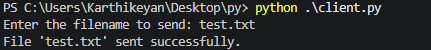

# Experiment 6 — File transfer using TCP sockets

[Back to experiment index](../README.md)

The client and server run on the same computer. The supplied code has been formatted and the filename is sent as a separate line, so TCP cannot merge it indistinguishably with the file contents. The server saves `received_<filename>` in its working folder, replacing an existing file with that name.

## A — File server

### Aim

To receive a file over TCP and save its binary contents.

### Algorithm

1. Create a TCP socket, enable address reuse, and bind to 127.0.0.1 on port 12345.
2. Listen for and accept one client.
3. Read a newline-terminated filename from a buffered input stream.
4. Open received_<filename> in binary write mode.
5. Read the remaining bytes in chunks and write them to the file.
6. When the client finishes, close the file and connection.

### Program

Source file: [A_file_server.py](A_file_server.py)

Start the server in terminal 1 from this folder:

```bash
python3 A_file_server.py
```

```python
import socket
from pathlib import Path


def file_transfer_server():
    try:
        with socket.socket(socket.AF_INET, socket.SOCK_STREAM) as server_socket:
            server_socket.setsockopt(socket.SOL_SOCKET, socket.SO_REUSEADDR, 1)
            server_socket.bind(('127.0.0.1', 12345))
            server_socket.listen(1)
            print("Server listening on port 12345...")
            connection, client_address = server_socket.accept()
            with connection:
                print(f"Connected by {client_address}")
                # Read a complete filename line, then the remaining file bytes.
                with connection.makefile('rb') as incoming:
                    header = incoming.readline(4097)
                    if not header.endswith(b'\n') or len(header) > 4096:
                        raise ValueError("Invalid filename header")
                    filename = Path(header[:-1].decode('utf-8')).name
                    if not filename or filename in ('.', '..'):
                        raise ValueError("Invalid filename")
                    print(f"Receiving file: {filename}")
                    with open(f"received_{filename}", 'wb') as file:
                        while True:
                            data = incoming.read(1024)
                            if not data:
                                break
                            file.write(data)
                print(f"File saved as received_{filename}")
    except Exception as e:
        print("Error:", e)


if __name__ == '__main__':
    file_transfer_server()
```

### Output

Sample output from the supplied lab material. Values depend on the computer and network.


### Result

The server reconstructs the received file. Local checks confirmed identical contents for a multi-chunk binary file and an empty file.

## B — File client

### Aim

To read a local file and transmit its name and contents to the TCP server.

### Algorithm

1. Read the input filename and verify that it is a file.
2. Connect to 127.0.0.1 on port 12345.
3. Send the base filename followed by a newline.
4. Open the file in binary mode.
5. Read and send chunks until the end of the file.
6. Shut down the sending side and close the socket.

### Program

Source file: [B_file_client.py](B_file_client.py)

Start the client in terminal 2 from this folder:

```bash
python3 B_file_client.py
```

Enter `test.txt` to use the included sample file. Compare `test.txt` with `received_test.txt` after the server exits.

```python
import socket
from pathlib import Path


def file_transfer_client():
    filename = input("Enter the filename to send: ")
    path = Path(filename)
    if not path.is_file():
        print(f"Error: File '{filename}' not found.")
        return
    if '\n' in path.name or '\r' in path.name:
        print("Error: Filename cannot contain a newline.")
        return
    try:
        with socket.socket(socket.AF_INET, socket.SOCK_STREAM) as client_socket:
            client_socket.connect(('127.0.0.1', 12345))
            client_socket.sendall((path.name + '\n').encode('utf-8'))
            with path.open('rb') as file:
                while True:
                    chunk = file.read(1024)
                    if not chunk:
                        break
                    client_socket.sendall(chunk)
            client_socket.shutdown(socket.SHUT_WR)
        print(f"File '{filename}' sent successfully.")
    except Exception as e:
        print("Error:", e)


if __name__ == '__main__':
    file_transfer_client()
```

### Output

Sample output from the supplied lab material. Values depend on the computer and network.



### Result

The client transmits the selected file to the server over TCP.
