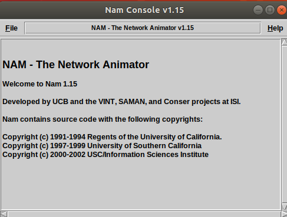
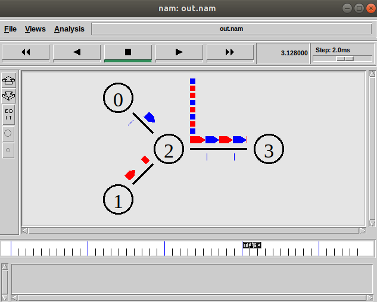

# Experiment 8 — TCP and UDP simulation using NS2

[Back to experiment index](../README.md)

Run this Tcl script with `ns`, not Python. Supplied screenshots are reference output; the simulation has not been rerun in this environment.

## Aim

To simulate FTP traffic over TCP and constant-bit-rate traffic over UDP in a shared network.

## Algorithm

1. Create an NS2 simulator and open a NAM trace file.
2. Create four nodes and connect them with duplex links.
3. Set the bottleneck queue limit and topology layout.
4. Attach TCP and a TCP sink between nodes 0 and 3, then attach an FTP application.
5. Attach UDP and a Null sink between nodes 1 and 3, then attach a CBR application.
6. Schedule the start and stop times for both traffic sources.
7. Flush and close the trace at five seconds and open the animation in NAM.

## Program

Source file: [tcp_udp.tcl](tcp_udp.tcl)

Run from this experiment folder:

```bash
ns tcp_udp.tcl
```

Requires NS2 and NAM. The script generates `out.nam`. The CBR packet size uses the NS2 parameter `packetSize_`.

```tcl
# Create simulator
set ns [new Simulator]

# Define colors
$ns color 1 Blue
$ns color 2 Red

# Open NAM trace file
set nf [open out.nam w]
$ns namtrace-all $nf

# Finish procedure
proc finish {} {
    global ns nf
    $ns flush-trace
    close $nf
    exec nam out.nam &
    exit 0
}

# Create nodes
set n0 [$ns node]
set n1 [$ns node]
set n2 [$ns node]
set n3 [$ns node]

# Create links
$ns duplex-link $n0 $n2 2Mb 10ms DropTail
$ns duplex-link $n1 $n2 2Mb 10ms DropTail
$ns duplex-link $n2 $n3 1.7Mb 20ms DropTail

# Queue limit
$ns queue-limit $n2 $n3 10

# Link orientation (for NAM)
$ns duplex-link-op $n0 $n2 orient right-down
$ns duplex-link-op $n1 $n2 orient right-up
$ns duplex-link-op $n2 $n3 orient right
$ns duplex-link-op $n2 $n3 queuePos 0.5

# TCP setup
set tcp [new Agent/TCP]
$tcp set class_ 2
$tcp set fid_ 1

$ns attach-agent $n0 $tcp

set sink [new Agent/TCPSink]
$ns attach-agent $n3 $sink

$ns connect $tcp $sink

# FTP over TCP
set ftp [new Application/FTP]
$ftp attach-agent $tcp
$ftp set type_ FTP

# UDP setup
set udp [new Agent/UDP]
$udp set fid_ 2
$ns attach-agent $n1 $udp

set null [new Agent/Null]
$ns attach-agent $n3 $null

$ns connect $udp $null

# CBR over UDP
set cbr [new Application/Traffic/CBR]
$cbr attach-agent $udp
$cbr set type_ CBR
$cbr set packetSize_ 1000
$cbr set rate_ 1mb
$cbr set random_ false

# Scheduling events
$ns at 0.1 "$cbr start"
$ns at 1.0 "$ftp start"
$ns at 4.0 "$ftp stop"
$ns at 4.5 "$cbr stop"

# Detach agents
$ns at 4.5 "$ns detach-agent $n0 $tcp"
$ns at 4.5 "$ns detach-agent $n3 $sink"

# End simulation
$ns at 5.0 "finish"

# Print values
puts "CBR packet size = [$cbr set packetSize_]"
puts "CBR interval = [$cbr set interval_]"

# Run simulation
$ns run
```

## Output

Supplied NS2/NAM output screenshots:





TCP traffic uses flow ID 1 (blue), and UDP traffic uses flow ID 2 (red).

## Result

The supplied animation shows TCP and UDP traffic sharing the bottleneck link. TCP provides retransmission and congestion control; UDP itself does not guarantee delivery.
